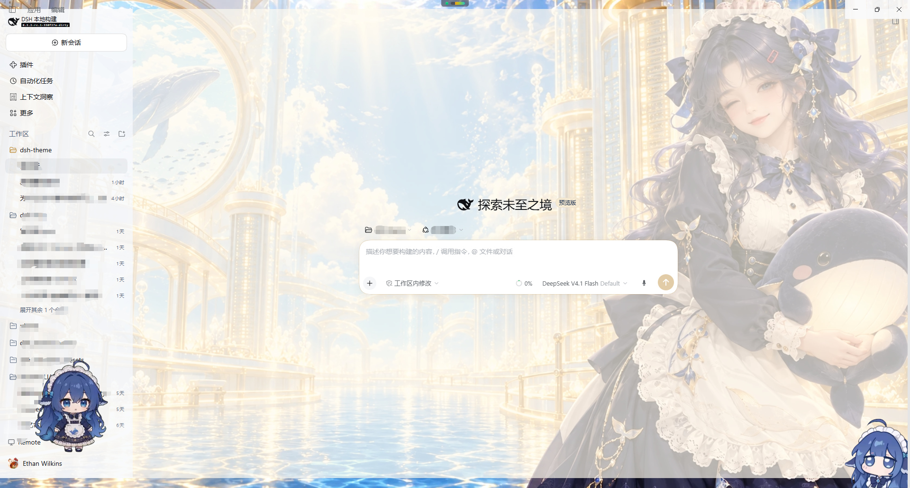
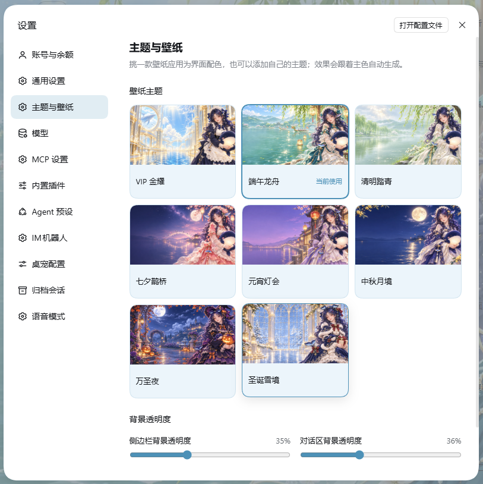
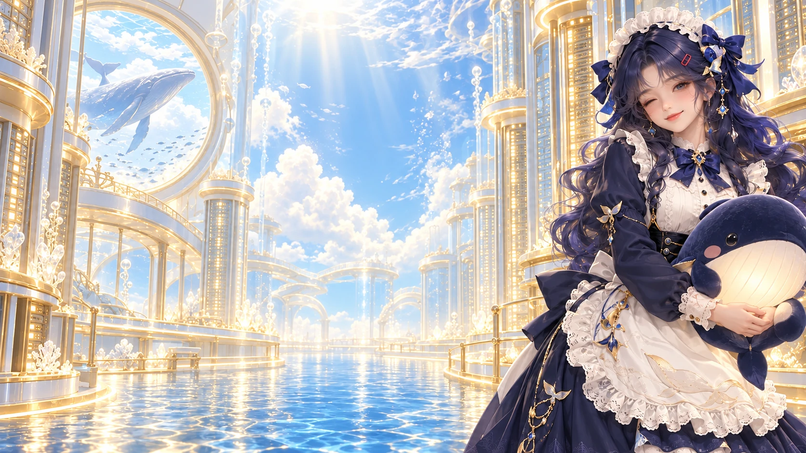
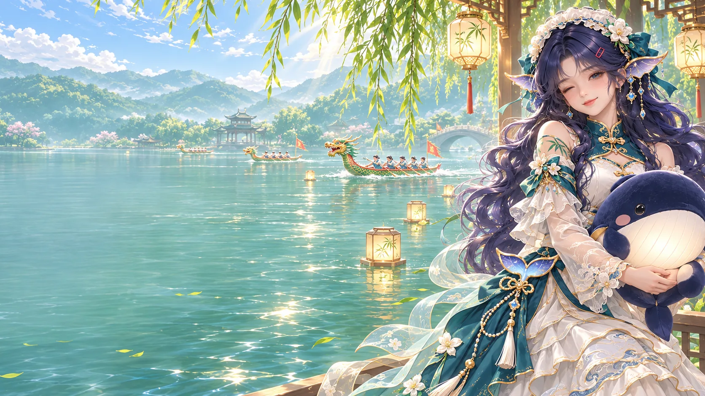
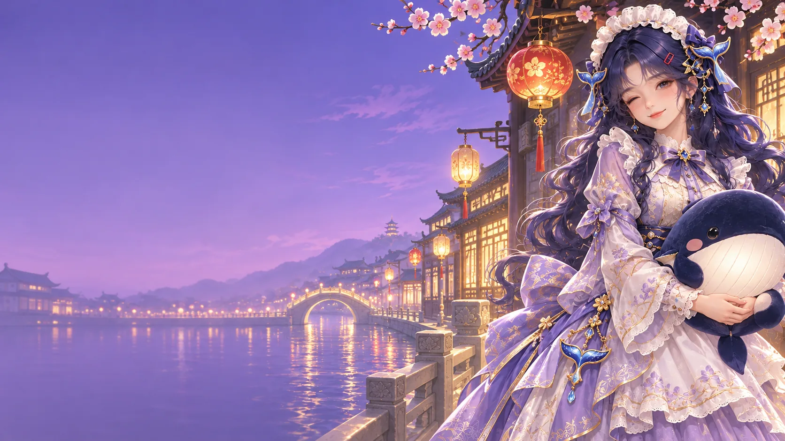
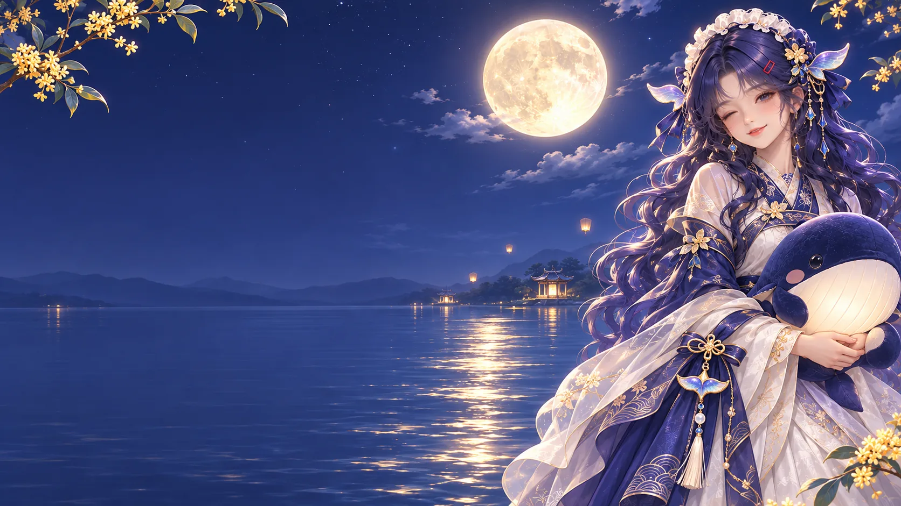
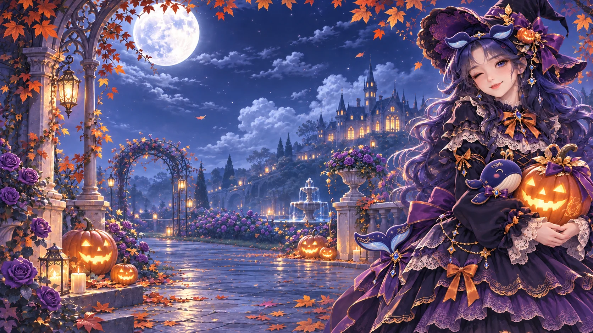

# @tinyforge/dsh-theme

English | [中文](README.zh.md)

## Summary

WJ Dreamlight is an optional Web profile bundle with eight selectable themes, matching wallpapers, palettes, and previews — plus a generic theme interface so more themes, including ones you define yourself, reuse the same effect layer. VIP Golden Radiance adds gold accents, glass surfaces, a licensed display font, and light effects. The bundle and selected theme stay with the profile when DSH is upgraded.

## Interface previews

<p align="center"></p>

### Wallpaper gallery

<p align="center"></p>

## Theme gallery

<table>
  <tr>
    <td align="center"><br><strong>VIP Golden Radiance</strong></td>
    <td align="center"><br><strong>Dragon Boat Festival</strong></td>
    <td align="center"><br><strong>Qingming Festival</strong></td>
  </tr>
  <tr>
    <td align="center"><br><strong>Qixi Festival</strong></td>
    <td align="center"><br><strong>Lantern Festival</strong></td>
    <td align="center"><br><strong>Mid-Autumn Festival</strong></td>
  </tr>
  <tr>
    <td align="center"><br><strong>Halloween Night</strong></td>
    <td align="center"><br><strong>Christmas Snowglow</strong></td>
  </tr>
</table>

## Use this package

Choose one installation method for the Web profile:

- **Official:** Open **Settings → Plugins → More → Official**, find **WJ Dreamlight**, then install and enable it.
- **npm registry:** Run `dsh plugin --profile desktop add @tinyforge/dsh-theme@1.1.0`.
- **From this Git repository:** Run `dsh plugin --profile desktop add git+https://github.com/phoenixlucky/dsh-theme.git#main`.
- **Local copy:** Run `dsh plugin --profile web add E:\home\dsh-theme`.

The current package id is `@tinyforge/dsh-theme` and its bundle version is `1.1.0`. The bundle supports DSH `0.2.1-rc.3`, `0.2.2-alpha.2`, and later stable `0.2.x` releases. Its `dsh-client-ui-theme` dependency accepts the matching compatible releases; that dependency version is not this bundle's install version. Install through `dsh plugin` so Harness records the bundle in the profile.

Open **Settings → Themes & wallpaper** — the gallery has a Settings page of its own, next to General — to browse the eight themes and adjust separate 0–100% background-transparency sliders for the sidebar and conversation area. Select a card to preview its wallpaper, then choose **Apply theme** to switch; the theme and transparency values are saved in the `dsh-theme` plugin configuration for the current profile and restored after restart on clients that load this Web plugin. At 0%, the original theme surfaces are preserved. Wallpaper visibility at higher values still depends on whether the host canvas is transparent. The gallery also follows the host theme settings for light, dark, and system, and saves whichever of the three you pick, so a restart keeps that palette instead of falling back to the system setting. Enabling the bundle preserves the current theme preference, including `system`; choose VIP Golden Radiance from the gallery to apply it. Disabling the bundle removes the gallery, its eight themes, and their assets, while the built-in light, dark, and system palettes remain available. Existing `official-vip-dream` preferences migrate to VIP Golden Radiance.

The browser plugin registers the eight themes through `ctx.theme` and adds its own `settings.section` page — wallpaper grid, surface-transparency sliders, and the custom-theme editor — instead of a row inside General. The page uses Harness configuration forms to save and restore theme and opacity settings in the profile. VIP styling is applied through a disposable stylesheet effect. Wallpaper images and the licensed display font ship with the bundle, so they need no network request or files from the application installation directory.

## Add your own theme

Every wallpaper theme is declared, not hand-styled. A theme supplies two effect inputs — an accent color and the light or dark surface it sits on — and the bundled stylesheet derives the glass panels, accent borders, hover and selected states, scrollbar tint, and the wallpaper atmosphere from them. Adding a theme therefore needs no CSS.

- **From the gallery:** open **Settings → Themes & wallpaper**, choose **Add custom theme**, and fill in a name, an image URL (`https://…`, `data:image/…`, or an app-relative `/…` path), an accent color, and whether it sits on the light or dark palette. Custom themes appear in the same grid with a **Custom** badge, can be edited or deleted from their preview, and are stored in the profile's `dsh-theme` configuration as `customThemes`.
- **From code:** append one entry to `builtInThemes` in `lib/client.js`, or call `ctx.theme.register(createWallpaperTheme({ … }))`. The spec is `id`, `accent`, `wallpaper`, `colorScheme`, and optional `surface`, `ink`, `overlay`, `labels`, and `extraTokens` for raw token overrides.

```js
createWallpaperTheme({
  id: "official-my-theme",
  colorScheme: "light",
  accent: "#4d91b7",   // drives brand color, borders, hover tints, atmosphere
  surface: "#f6fbff",  // the glass base the panels are mixed from
  wallpaper: myWallpaperAsset,
  labels: { zh: "我的主题", en: "My theme" }
});
```

The effect layer reads `--dsh-theme-accent` and `--dsh-theme-surface` from the registered tokens and namespaces its own values as `--dsh-theme-*`, so a theme can override any derived token without touching the stylesheet. Motion duration, hover lift, glass fills, borders, and the wallpaper atmosphere stay separate tokens, and decorative motion is disabled under `prefers-reduced-motion`.

## Supported versions

This bundle targets DSH `0.2.1-rc.3`, `0.2.2-alpha.2`, and later stable `0.2.x` releases whose `dsh-client-ui-theme` exports the external theme metadata fields. A DSH release outside those ranges needs a compatible bundle release.

## License

The wallpaper artwork is packaged under `assets/`. The GuruQiuWan display font and its Apache-2.0 notice are included there as well; see `font-license.txt` and `LICENSE-2.0.txt`.

## Related documentation

- [Theme extension API](../../client/ui-theme/README.md#registering-a-theme)
- [VIP Golden Radiance detail](docs/DETAIL.md)
