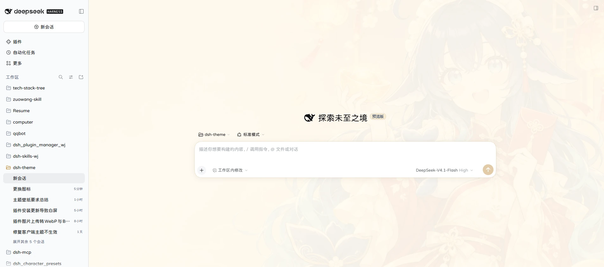
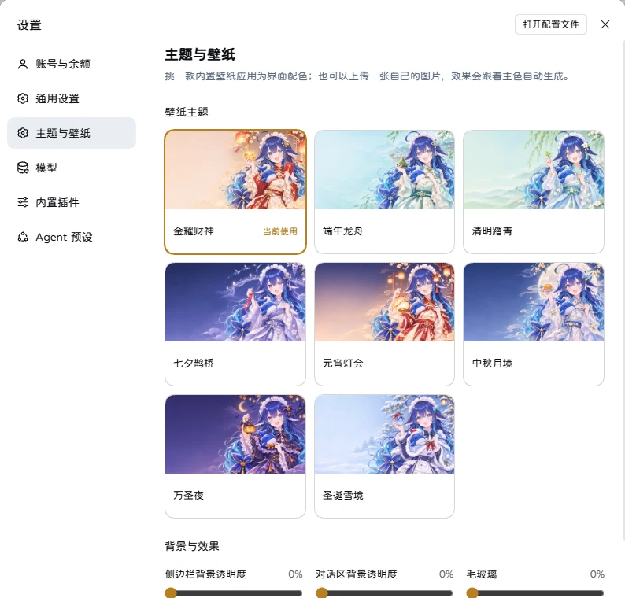
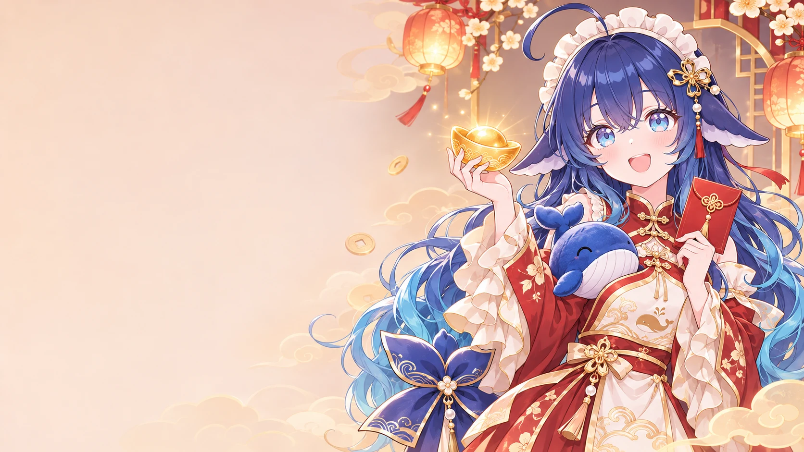
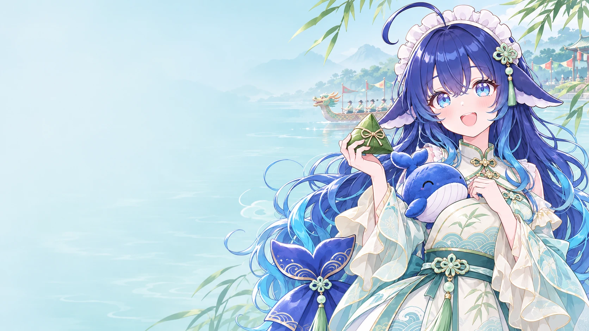
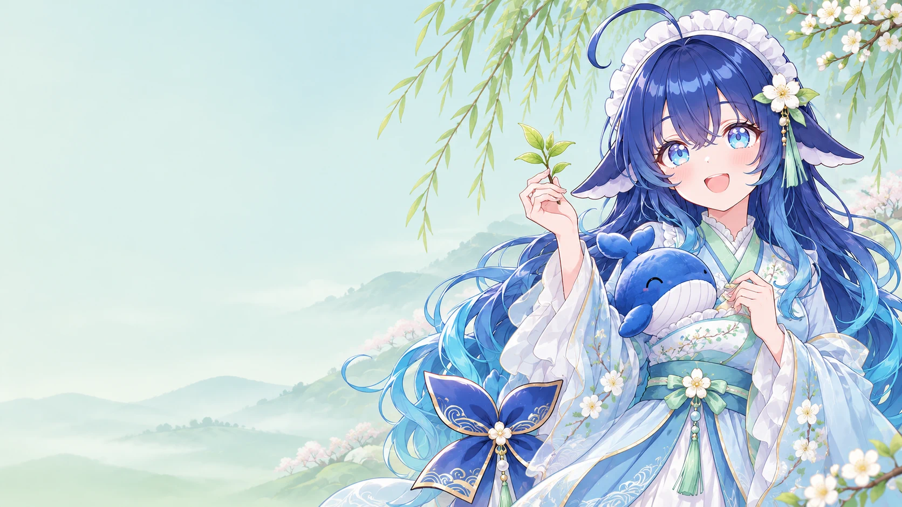
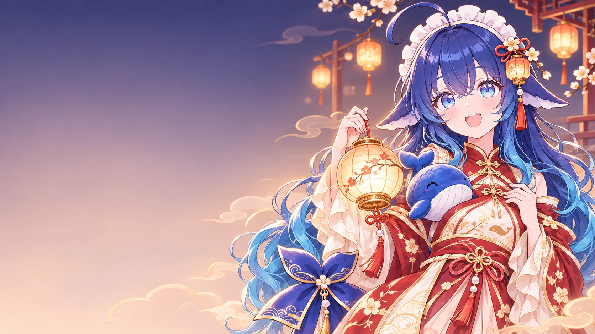
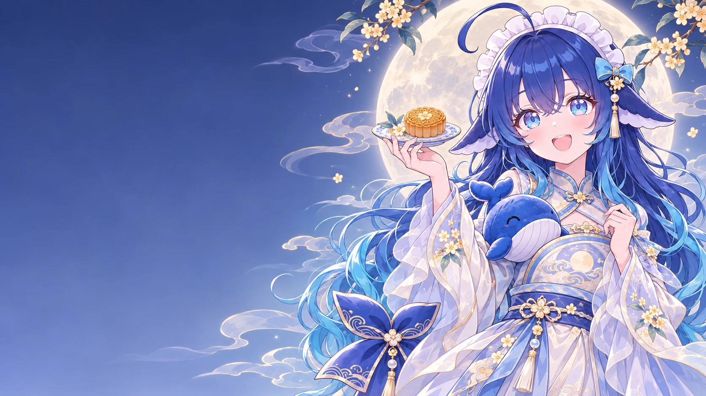
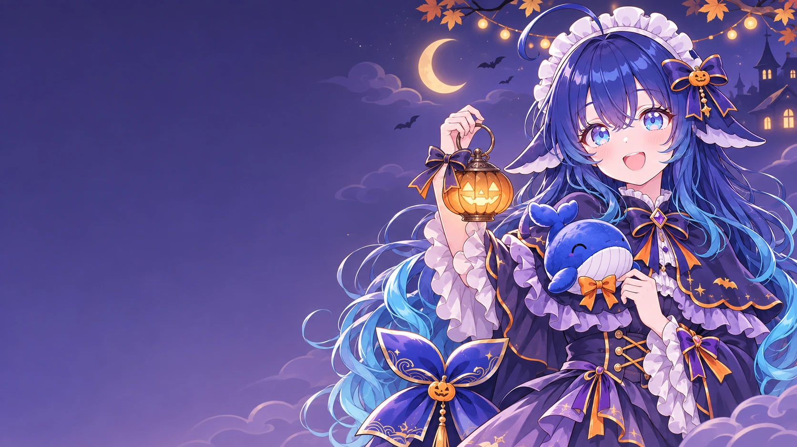

# @tinyforge/dsh-theme

English | [中文](README.zh.md)

## Summary

WJ Dreamlight adds eight selectable festival themes, matching wallpapers, palettes, and previews to DSH Web and desktop clients. It also provides transparency controls and a reusable theme interface for custom themes. Golden God of Wealth adds gold accents, glass surfaces, a licensed display font, and light effects. The bundle and selected theme stay with the profile when DSH is upgraded. Using a custom remote wallpaper connects the client to the image host.

## Interface previews

<p align="center"></p>

### Wallpaper gallery

<p align="center"></p>

## Theme gallery

<table>
  <tr>
    <td align="center"><br><strong>Golden God of Wealth</strong></td>
    <td align="center"><br><strong>Dragon Boat Festival</strong></td>
    <td align="center"><br><strong>Qingming Festival</strong></td>
  </tr>
  <tr>
    <td align="center"><br><strong>Qixi Festival</strong></td>
    <td align="center"><br><strong>Lantern Festival</strong></td>
    <td align="center"><br><strong>Mid-Autumn Festival</strong></td>
  </tr>
  <tr>
    <td align="center"><br><strong>Halloween Night</strong></td>
    <td align="center"><br><strong>Christmas Snowglow</strong></td>
  </tr>
</table>

## Use this package

Choose one installation method for your DSH Web or desktop profile:

- **Official:** Open **Settings → Plugins → More → Official**, find **WJ Dreamlight**, then install and enable it.
- **npm registry:** Run `dsh plugin --profile desktop add @tinyforge/dsh-theme@1.2.4`.
- **From this Git repository:** Run `dsh plugin --profile desktop add git+https://github.com/phoenixlucky/dsh-theme.git#main`.
- **Local copy:** Run `dsh plugin --profile web add E:\home\dsh-theme`.

The current package id is `@tinyforge/dsh-theme` and the latest version published to npm is `1.2.4`. The bundle supports DSH `0.2.1-rc.3`, `0.2.2-alpha.2`, and later stable `0.2.x` releases. Its `@deepseek-ai/dsh-client-ui-theme` peer dependency accepts the matching compatible releases; that version is not this bundle's install version. Install through `dsh plugin` so Harness records the bundle in the profile.

Open **Settings → Themes & wallpaper** — the gallery has a Settings page of its own, next to General — to browse the eight themes and use the **Background & effects** sliders: separate 0–100% background transparency for the sidebar and conversation area, plus a **frosted-glass** strength that applies to every wallpaper theme, built-ins included. Select a card to preview its wallpaper, then choose **Apply theme** to switch; the theme and transparency values are saved in the `dsh-theme` plugin configuration for the current profile and restored after restart on clients that load this Web plugin. Because the built-in palette setting stores only light, dark, and system, a wallpaper theme id stays an in-process choice: whenever the Host re-adopts its palette from a settings update, the plugin re-applies the saved theme, while choosing light, dark, or system in Appearance replaces the wallpaper. At 0%, the original theme surfaces are preserved; above that each slider is the share of wallpaper that shows through its own area, and the two stay independent. The Windows desktop window frame used to be painted with the sidebar fill under the conversation column, which made the sidebar slider move the conversation area; the plugin now clears just that frame and corrects for the Host painting each fill twice, so a 13% slider really is 13% wallpaper. The gallery also follows the host theme settings for light, dark, and system, and saves whichever of the three you pick, so a restart keeps that palette instead of falling back to the system setting. Enabling the bundle preserves the current theme preference, including `system`; choose Golden God of Wealth from the gallery to apply it. Disabling the bundle removes the gallery, its eight themes, and their assets, while the built-in light, dark, and system palettes remain available. Existing `official-vip-dream` preferences migrate to Golden God of Wealth.

The browser plugin registers the eight themes through `ctx.theme` and adds its own `settings.section` page — wallpaper grid, surface-transparency sliders, and the custom-theme editor — instead of a row inside General. The page uses Harness configuration forms to save and restore the theme, the two transparency values, and the glass strength in the profile; the glass is one plugin-owned wallpaper layer, so it needs no per-theme state. The theme's extra styling is applied through a disposable stylesheet effect. Wallpaper images and the licensed display font ship with the bundle, so they need no network request or files from the application installation directory. The eight built-in wallpapers are inlined in the client bundle as WebP data URLs, so no wallpaper request reaches the Host plugin asset route; the font cannot use that route because it publishes images only, so the bundle registers its own `/theme-font` route and the client probes it before enabling the display face. A composition that serves neither keeps the host text stack.

## Add your own theme

Every wallpaper theme is declared, not hand-styled. A theme supplies two effect inputs — an accent color and the light or dark surface it sits on — and the bundled stylesheet derives the glass panels, accent borders, hover and selected states, scrollbar tint, and the wallpaper atmosphere from them. Adding a theme therefore needs no CSS.

- **From the gallery:** open **Settings → Themes & wallpaper** and, in the **Local upload** block, choose **Upload local image**; fill in a name, an image (a local file, or an `https://…`, `data:image/…`, or app-relative `/…` URL), an accent color, and whether it sits on the light or dark palette. **One per profile:** once the slot is filled the button reads **Edit local upload**, the eight built-in wallpapers store only their theme id, and this single wallpaper appears in the same grid with a **Local** badge. It can be edited or deleted from its preview and is stored in the profile's `dsh-theme` configuration as `customThemes` (at most one entry).
- **Local uploads:** choose **Upload local image**, or drop a file on the dashed field. The client decodes the image in the browser, re-encodes it as WebP with a 2560 px longest edge, and saves the `data:image/webp;base64,…` value into that wallpaper's `wallpaper` field — no network request, no copy elsewhere, and no host file API. Editing shows a thumbnail plus a dimensions · size summary, and **Remove image** switches back to a URL. Source files are capped at 24 MB, alpha is preserved, and an encode that would exceed about 900,000 characters steps down through smaller sizes and quality.
- **From code:** append one entry to `builtInThemes` in `lib/client.js`, or call `ctx.theme.register(createWallpaperTheme({ … }))`. The spec is `id`, `accent`, `wallpaper`, `colorScheme`, and optional `surface`, `ink`, `overlay`, `labels`, and `extraTokens` for raw token overrides.

```js
createWallpaperTheme({
  id: "official-my-theme",
  colorScheme: "light",
  accent: "#4d91b7",   // drives brand color, borders, hover tints, atmosphere
  surface: "#f6fbff",  // the glass base the panels are mixed from
  wallpaper: myWallpaperAsset,
  labels: { zh: "我的主题", en: "My theme" }
});
```

The effect layer reads `--dsh-theme-accent` and `--dsh-theme-surface` from the registered tokens and namespaces its own values as `--dsh-theme-*`, so a theme can override any derived token without touching the stylesheet. Motion duration, hover lift, glass fills, borders, and the wallpaper atmosphere stay separate tokens, and decorative motion is disabled under `prefers-reduced-motion`.

## Supported versions

This bundle targets DSH `0.2.1-rc.3`, `0.2.2-alpha.2`, and later stable `0.2.x` releases whose `dsh-client-ui-theme` exports the external theme metadata fields. A DSH release outside those ranges needs a compatible bundle release.

## License

The plugin source code and documentation are licensed under MIT; see `LICENSE`. The GuruQiuWan display font has a separate Apache-2.0 license, with its notice and full text in `assets/font-license.txt` and `assets/LICENSE-2.0.txt`.

## Related documentation

- [Theme extension API](../../client/ui-theme/README.md#registering-a-theme)
- [Golden God of Wealth detail](docs/DETAIL.md)
