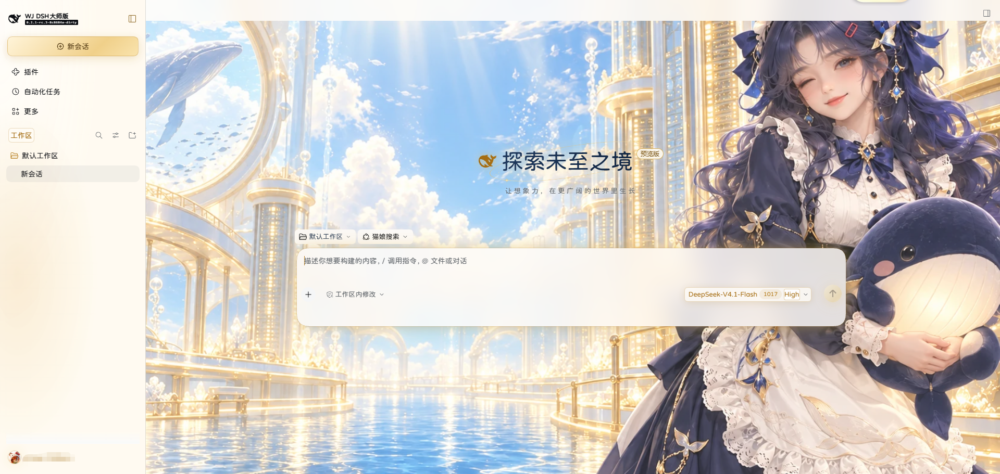

# @deepseek-ai/dsh-theme

[English](README.md) | 中文

## 概述

这是面向 Web 配置档案的可选插件，提供六款主题及对应的壁纸、配色和预览。VIP 金耀还包含金色界面强调、玻璃表面、授权显示字体和光影效果。插件及主题选择保存在配置档案中，DSH 升级后仍会保留。

## 页面预览

## 主题预览

<table>
  <tr>
    <td align="center"> <strong>VIP 金耀</strong></td>
    <td align="center"> <strong>海盐蓝</strong></td>
    <td align="center"> <strong>竹青</strong></td>
  </tr>
  <tr>
    <td align="center"> <strong>珊瑚粉</strong></td>
    <td align="center"> <strong>薰衣草紫</strong></td>
    <td align="center"> <strong>午夜靛蓝</strong></td>
  </tr>
</table>

## 使用本包

为 Web 配置档案选择以下任一安装方式：

- **官方安装：** 打开 **设置 → 插件 → 更多 → 官方**，找到 **VIP 金耀**，然后安装并启用。
- **本地安装：** 运行 `dsh plugin --profile web add E:\home\dsh-theme`。

在「主题与壁纸」页面选择卡片后，主题 id 会保存到 `ui-theme`，重启后仍会保留。新配置档案使用默认系统配色时，启用插件会默认选择 VIP 金耀。停用插件会移除六张主题卡和资源，内置的浅色、深色及系统配色仍可使用；旧设置中的 `official-vip-dream` 会迁移为 VIP 金耀。

浏览器插件通过 `ctx.theme` 注册六款主题，并通过可卸载的 effect 安装 VIP 样式。壁纸和授权字体均包含在插件包中，无需联网下载，也不依赖应用安装目录中的文件。

## 支持版本

本插件面向 DSH `0.2.1-rc.3` 及后续 `0.2.x` 版本，这些版本的 `dsh-client-ui-theme` 导出外部主题元数据字段。超出该范围的 DSH 版本需要使用兼容版本的插件。

## 许可

壁纸美术资源均包含在包内。GuruQiuWan 显示字体及 Apache-2.0 许可声明也随包提供，详见 `font-license.txt` 和 `LICENSE-2.0.txt`。

## 相关文档

- [主题扩展 API](../../client/ui-theme/README.zh.md#registering-a-theme)
- [VIP 金耀详情](docs/DETAIL.zh.md)
