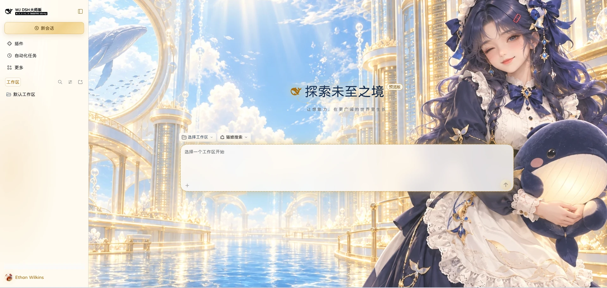

# @deepseek-ai/dsh-theme

[English](README.md) | 中文

## 概述

**WJ 星耀主题**是面向 Web 配置档案的可选插件，提供六款主题及对应的壁纸、配色和预览。VIP 金耀还包含金色界面强调、玻璃表面、授权显示字体和光影效果。插件及主题选择保存在配置档案中，DSH 升级后仍会保留。

## 页面预览

## 主题预览

<table>
  <tr>
    <td align="center"> <strong>VIP 金耀</strong></td>
    <td align="center"> <strong>海盐蓝</strong></td>
    <td align="center"> <strong>竹青</strong></td>
  </tr>
  <tr>
    <td align="center"> <strong>珊瑚粉</strong></td>
    <td align="center"> <strong>薰衣草紫</strong></td>
    <td align="center"> <strong>午夜靛蓝</strong></td>
  </tr>
</table>

## 使用本包

为 Web 配置档案选择一种安装方式：

- **官方安装：** 打开 **设置 → 插件 → 更多 → 官方**，找到 **WJ 星耀主题**，然后安装并启用。
- **从 Git 仓库安装：** 运行 `dsh plugin --profile desktop add git+https://github.com/phoenixlucky/dsh-theme.git#main`。
- **本地安装：** 运行 `dsh plugin --profile web add E:\home\dsh-theme`。

当前包名为 `@deepseek-ai/dsh-theme`，主题插件自身版本为 `1.0.19`。本插件兼容 DSH `0.2.1-rc.3`、`0.2.2-alpha.2` 及后续稳定版 `0.2.x`；`dsh-client-ui-theme` 依赖会接受对应兼容版本。它的依赖版本不是本插件的安装版本。请通过 `dsh plugin` 安装，让 Harness 同时记录依赖和 profile 中的 bundle 选择。Registry 返回 `404` 表示请求的包名或版本在该源不可用；切换镜像不会发布这个包。

启用后，在 **设置 → 通用 → 主题与壁纸** 中浏览六款主题，并分别调整侧边栏与对话区背景透明度（0–100%）。点卡片先查看大图预览，再点「应用主题」切换；主题和透明度设置保存在当前配置档案的 `dsh-theme` 插件配置中，重启后会自动恢复，并同步到加载此 Web 插件的端。透明度为 0 时保留原主题表面；调高后壁纸能否显示还取决于宿主画布是否透明。图库也会同步宿主主题设置中的浅色、深色和系统选项，并保存你在三者中的选择，重启后仍使用该配色，而不会退回跟随系统。启用插件时会保留当前主题偏好，包括「系统」；如需使用 VIP 金耀，请在图库中选择。停用插件会移除主题选择界面、六款主题和相关资源，内置的浅色、深色及系统配色仍可使用；旧设置中的 `official-vip-dream` 会迁移为 VIP 金耀。

浏览器插件通过 `ctx.theme` 注册六款主题，并在 DSH 通用设置扩展点提供壁纸图库；图库通过 Harness 配置表单保存并恢复第三方主题选择。VIP 样式通过可卸载的 effect 安装。壁纸和授权字体均包含在插件包中，无需联网下载，也不依赖应用安装目录中的文件。

## 支持版本

本插件面向 DSH `0.2.1-rc.3`、`0.2.2-alpha.2` 及后续稳定版 `0.2.x`，这些版本的 `dsh-client-ui-theme` 导出外部主题元数据字段。超出这些范围的 DSH 版本需要使用兼容版本的插件。

## 许可

壁纸美术资源均包含在包内。GuruQiuWan 显示字体及 Apache-2.0 许可声明也随包提供，详见 `font-license.txt` 和 `LICENSE-2.0.txt`。

## 相关文档

- [主题扩展 API](../../client/ui-theme/README.zh.md#registering-a-theme)
- [VIP 金耀详情](docs/DETAIL.zh.md)
