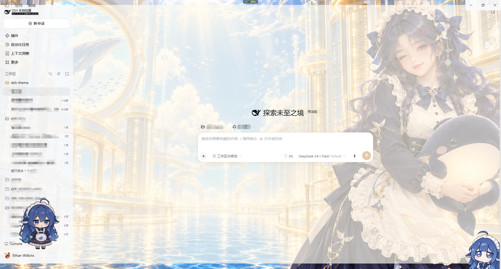
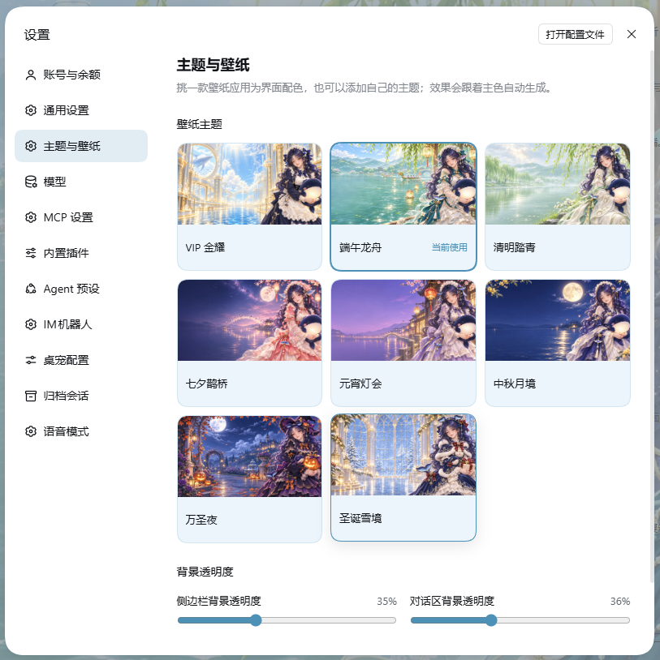

# @tinyforge/dsh-theme

[English](README.md) | 中文

## 概述

**WJ 星耀主题**是面向 Web 配置档案的可选插件，提供八款主题及对应的壁纸、配色和预览，并提供通用的主题接口：后续新增的主题（包括你自己定义的主题）都复用同一套效果层。VIP 金耀还包含金色界面强调、玻璃表面、授权显示字体和光影效果。插件及主题选择保存在配置档案中，DSH 升级后仍会保留。

## 页面预览

<p align="center"></p>

### 主题图库

<p align="center"></p>

## 主题预览

<table>
  <tr>
    <td align="center"><br><strong>VIP 金耀</strong></td>
    <td align="center"><br><strong>端午龙舟</strong></td>
    <td align="center"><br><strong>清明踏青</strong></td>
  </tr>
  <tr>
    <td align="center"><br><strong>七夕鹊桥</strong></td>
    <td align="center"><br><strong>元宵灯会</strong></td>
    <td align="center"><br><strong>中秋月境</strong></td>
  </tr>
  <tr>
    <td align="center"><br><strong>万圣夜</strong></td>
    <td align="center"><br><strong>圣诞雪境</strong></td>
  </tr>
</table>

## 使用本包

为 Web 配置档案选择一种安装方式：

- **官方安装：** 打开 **设置 → 插件 → 更多 → 官方**，找到 **WJ 星耀主题**，然后安装并启用。
- **npm registry：** 运行 `dsh plugin --profile desktop add @tinyforge/dsh-theme@1.1.0`。
- **从 Git 仓库安装：** 运行 `dsh plugin --profile desktop add git+https://github.com/phoenixlucky/dsh-theme.git#main`。
- **本地安装：** 运行 `dsh plugin --profile web add E:\home\dsh-theme`。

当前包名为 `@tinyforge/dsh-theme`，主题插件自身版本为 `1.1.0`。本插件兼容 DSH `0.2.1-rc.3`、`0.2.2-alpha.2` 及后续稳定版 `0.2.x`；`dsh-client-ui-theme` 依赖会接受对应兼容版本。它的依赖版本不是本插件的安装版本。请通过 `dsh plugin` 安装，让 Harness 同时记录依赖和 profile 中的 bundle 选择。

启用后，在 **设置 → 主题与壁纸**（图库现在是设置里的独立页面，排在「通用」之后）中浏览八款主题，并分别调整侧边栏与对话区背景透明度（0–100%）。点卡片先查看大图预览，再点「应用主题」切换；主题和透明度设置保存在当前配置档案的 `dsh-theme` 插件配置中，重启后会自动恢复，并同步到加载此 Web 插件的端。透明度为 0 时保留原主题表面；调高后壁纸能否显示还取决于宿主画布是否透明。图库也会同步宿主主题设置中的浅色、深色和系统选项，并保存你在三者中的选择，重启后仍使用该配色，而不会退回跟随系统。启用插件时会保留当前主题偏好，包括「系统」；如需使用 VIP 金耀，请在图库中选择。停用插件会移除主题选择界面、八款主题和相关资源，内置的浅色、深色及系统配色仍可使用；旧设置中的 `official-vip-dream` 会迁移为 VIP 金耀。

浏览器插件通过 `ctx.theme` 注册八款主题，并用独立的 `settings.section` 页面承载壁纸网格、透明度滑杆和自定义主题编辑器（不再塞进「通用」里的一行）；页面通过 Harness 配置表单保存并恢复第三方主题选择。VIP 样式通过可卸载的 effect 安装。壁纸和授权字体均包含在插件包中，无需联网下载，也不依赖应用安装目录中的文件。

## 自定义主题与扩展

每款壁纸主题都是「声明式」的：只需给出两个效果输入——主题色，以及它所在的浅色或深色表面——样式表就会自动派生玻璃面板、强调色边框、悬停与选中态、滚动条着色和壁纸氛围层。因此新增一款主题不需要写任何 CSS。

- **在图库里自定义：** 打开 **设置 → 主题与壁纸**，点「添加自定义主题」，填写名称、图片地址（`https://…`、`data:image/…` 或应用内 `/…` 路径）、主题色，以及浅色/深色外观。自定义主题和图库内置主题一起显示，带「自定义」标记；在预览里可以继续编辑或删除。它们保存在配置档案 `dsh-theme` 的 `customThemes` 字段中，重启后仍然可用。
- **从代码扩展：** 在 `lib/client.js` 的 `builtInThemes` 里加一条，或直接调用 `ctx.theme.register(createWallpaperTheme({ … }))`。字段为 `id`、`accent`、`wallpaper`、`colorScheme`，以及可选的 `surface`、`ink`、`overlay`、`labels` 和用于覆盖原始 token 的 `extraTokens`。

```js
createWallpaperTheme({
  id: "official-my-theme",
  colorScheme: "light",
  accent: "#4d91b7",   // 决定主色、边框、悬停态和氛围层
  surface: "#f6fbff",  // 玻璃面板的混合基底
  wallpaper: myWallpaperAsset,
  labels: { zh: "我的主题", en: "My theme" }
});
```

效果层只读取注册的 `--dsh-theme-accent` 和 `--dsh-theme-surface`，其余取值都以 `--dsh-theme-*` 命名空间暴露，因此主题可以按需覆盖任一派生值而不必改样式表。动效时长、悬停位移、玻璃填充、边框和壁纸氛围各自独立成 token；在 `prefers-reduced-motion` 下会关闭装饰性动效。

## 支持版本

本插件面向 DSH `0.2.1-rc.3`、`0.2.2-alpha.2` 及后续稳定版 `0.2.x`，这些版本的 `dsh-client-ui-theme` 导出外部主题元数据字段。超出这些范围的 DSH 版本需要使用兼容版本的插件。

## 许可

壁纸美术资源均包含在包内。GuruQiuWan 显示字体及 Apache-2.0 许可声明也随包提供，详见 `font-license.txt` 和 `LICENSE-2.0.txt`。

## 相关文档

- [主题扩展 API](../../client/ui-theme/README.zh.md#registering-a-theme)
- [VIP 金耀详情](docs/DETAIL.zh.md)
